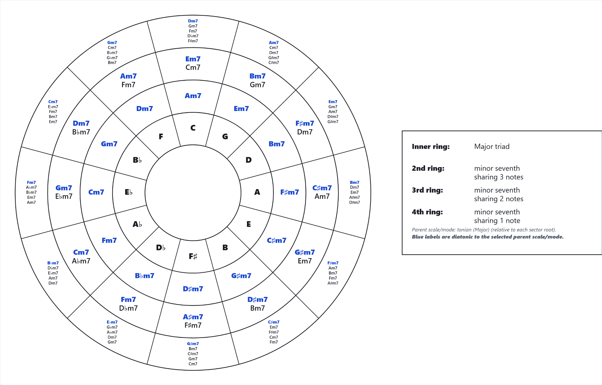

# Harmonic Circle Explorer

**Version 0.6.1**

Harmonic Circle Explorer is a standalone interactive tool for generating circular diagrams of chord relationships around the circle of fifths. It combines common-tone analysis, diatonic filtering, interactive comparison, voice-leading information, audio playback, and exportable SVG/PNG diagrams in a single self-contained application.

The diagrams place a selectable reference chord family in the inner chord ring. An optional innermost ring displays individual pitch classes. Successive outer rings contain a selected related chord family, grouped by the number of pitch classes each chord shares with the reference chord in the same sector. Chords with more common tones appear closer to the center.

## Example



*Example: major triads as the reference family and minor-seventh chords as the related family, with all relationships shown and diatonic chords highlighted for Ionian (Major).*

## Main features

- **Three harmony tools** in the upper toolbar: Harmonic Circle, Harmonic Path Finder, and Chord Comparison. Switching tools retains each tool's choices and the shared recording.
- **Harmonic Path Finder** finds sequences between two chosen chords, with exactly 2–4 transitions and a selected intermediate chord family or diatonic candidates from a fixed parent scale/tonic. It ranks up to five paths by accumulated pitch-class proximity and common-tone retention, not by functional-harmony rules. Play or add a path to the recording.
- **Chord Comparison** analyzes any two chosen root/family combinations, showing exact common pitch classes, exclusive tones, matched semitone movements, and unmatched tones. Each chord can be auditioned or recorded, and the transition can be played through the synthesizer.
- **Tool-specific SVG/PNG exports** for paths and chord comparisons, retaining the original circle export formats.

- Optional **inner note ring** with twelve individual pitch classes and single-note synthesis, enabled by default; legend and explanation reflect its visibility.
- **Progression recorder** for chord and note-ring clicks, sequence playback, staff preview via abcjs, and ABC/SVG notation downloads.
- **Six interface languages:** English, Spanish, French, Brazilian Portuguese, Italian, and German, with automatic browser-locale detection and manual selection.
- **Chord symbol styles:** compact, letter-based, and word-based, applied to diagram labels and comparisons.
- **Settings JSON export/import** for tool and playback configuration; chosen interface language persists locally. Shared settings apply to all applicable diagrams, while ring and diameter controls appear only for Harmonic Circle.
- Selectable **reference chord family** for the chord ring.
- Selectable **related chord family** for the outer rings.
- **All families (diatonic only)** mode combines every supported chord family in the same diagram while automatically restricting results to the selected parent scale/mode. The exact reference chord is not duplicated in the outer rings because it is already visible in the inner chord ring.
- Parent **scale or mode** used to determine which related chords are diatonic in each sector.
- **Ionian (major)** as the default parent scale/mode.
- Show **all relationships** or **diatonic relationships only**.
- When all relationships are shown, optionally **highlight diatonic chords**.
- Optional display of **enharmonic equivalents**; pitch-class duplicates are suppressed by default.
- Independent **outer-ring visibility controls** for every available shared-note count. Positive-overlap rings are on by default; the 0-shared-notes ring is off by default.
- Optional radial **segment separator lines**.
- Optional **legend**, with consistent two-column row alignment.
- Rich **chord tooltips** on hover showing chord family, chord tones, highlighted common tones, Roman numeral relative to the parent scale/mode, diatonic status, and voice-leading information.
- Optional generated **explanation box** for the current visualization, including notes about relationship rings removed by the diatonic filter.
- Adjustable **circle diameter** and **maximum font size**.
- Adaptive dense-sector layout: All-families diagrams use wider high-density bands and geometry-aware multi-column placement. Side sectors automatically transpose their text grid so horizontal chord labels do not collide before font size is reduced.
- Click any related chord to **compare it with the sector reference chord**; the selected pair and their shared tones appear in the center of the circle.
- Optional **chord-family color highlighting** while preserving a monochrome default.
- **Voice-leading analysis** in related-chord tooltips based on holding exact common tones and minimizing total semitone motion of the remaining paired voices.
- Click a chord to hear it as a **block chord** or **arpeggio**, with root-position or smooth voice-led playback; click a note-ring label to hear a single note.
- Export the current diagram as **SVG** or **PNG**.
- Presets for minor seventh, major seventh, dominant seventh, and diminished seventh diagrams with major triads as the reference family.

## Included chord families

The first release includes major, minor, diminished, augmented, suspended, sixth, and several seventh-chord families, including major seventh, dominant seventh, minor seventh, minor-major seventh, half-diminished seventh, diminished seventh, augmented seventh, and augmented-major seventh.

## Included parent scales and modes

The first release includes the seven diatonic modes (Ionian, Dorian, Phrygian, Lydian, Mixolydian, Aeolian, and Locrian), harmonic minor, melodic minor, harmonic major, major and minor pentatonic, and whole-tone scales.

Diatonic membership is always evaluated **relative to the selected parent scale or mode using the root of each circle-of-fifths sector as the tonic**. The outer rings still contain chords, never scales or modes.

## Running locally

Requires a current Node.js installation.

```bash
npm ci
npm run dev
```

Vite will print a local URL, normally `http://localhost:5173/`.

To verify the production build:

```bash
npm test
npm run build
npm run preview
```

## GitHub Pages

A GitHub Actions workflow is included in `.github/workflows/deploy.yml`. It installs dependencies, runs the harmonic-engine test suite, builds the Vite application, and deploys `dist/` to GitHub Pages. The Vite base path is relative (`./`), so the app is not tied to a specific repository name.

## Harmonic Path Finder and Chord Comparison

Choose a tool from the upper toolbar. Each tool has independent settings in the Tools sidebar. Relationship display is part of Harmonic context. Settings contains shared appearance, playback and preferences, plus a Harmonic Circle-only Diagram and rings section. Unused controls are hidden for the other tools. The recorder and download format remain shared.

**Path Finder:** Choose the starting and ending chord, 2–4 transitions, and eligible intermediate chords. Selecting a particular family searches all twelve chromatic roots of that family. **All diatonic families** restricts intermediate chords to the selected parent scale and tonic (independently of the circle’s selected mode (the circle evaluates each sector with its own parent root)). The endpoints are always honored even when outside the intermediate set. Results use exactly the chosen number of transitions, without repeated chords, and display up to five ranked candidate paths. If the constraints cannot be met, an unavailable result is shown. Lower scores combine less pitch-class movement, fewer unmatched tones and more common tones; the search uses a bounded beam and is not a proof of the global optimum. These are exploratory paths, not claims of tonal syntax, harmonic function or voice-leading in specified octaves.

**Chord Comparison:** Select two chords directly. The tool holds their shared pitch classes and matches the remaining distinct tones to minimize circular chromatic motion, reporting additions/removals separately when chord sizes differ. The interactive SVG and the more detailed sidebar explain the result; the notes are not acoustic measurements or register-specific voicings.

To hear an individual result, click its SVG chord or use the playback buttons. **Root position** plays each chord in its root-position MIDI arrangement; **Smooth voice leading** adjusts subsequent chord octaves relative to the preceding sounded chord in a path or A → B transition. These audition voicings do not change the pitch-class scores or nominal ABC notation. Add a path to the existing recording via the dedicated action. SVG/PNG export downloads the active tool's diagram, not all paths at once. The settings JSON format remains schema version 1 and accepts older settings without tool-selection fields.

## How the diagram is constructed

For each of the twelve circle-of-fifths sectors:

1. The selected reference chord is constructed from the sector root.
2. All twelve roots of the selected related chord family are generated. In **All families** mode, this is repeated for every supported family.
3. The pitch-class intersection between the reference chord and each related chord is counted.
4. Candidates are assigned to rings by shared-note count, highest count nearest the center.
5. Each available outer ring can be shown or hidden independently. Positive-overlap rings are visible by default; the 0-shared-notes ring starts hidden.
6. If **Diatonic only** is enabled, a related chord is retained only when all of its pitch classes belong to the selected parent scale/mode for that sector. **All families** mode always applies this rule, even if the ordinary diatonic-only setting was previously off.
7. If **Highlight diatonic** is enabled while all chords are shown, diatonic labels are drawn in blue (or bold/underlined when chord-family colors are active).

Enharmonic spellings affect labels only; the relationship engine works with pitch classes and does not duplicate enharmonically equivalent chords.

## Audio

Audio is triggered by clicking a chord or individual note-ring label, or by playing a recorded sequence. The application uses a lightweight Web Audio synthesizer. Root-position playback preserves the original behavior. **Smooth voice leading** plays the sector reference chord first and then the related chord in its minimum-motion voicing; in block mode, exact common tones are sustained across the change where possible. The harmonic engine itself remains pitch-class based and octave-independent; concrete octave placement is handled only by the audio layer so alternative renderers or host applications can choose their own voicing strategy.

## Documentation

See [docs/USER_GUIDE.md](docs/USER_GUIDE.md) for usage details, [docs/TECHNICAL_NOTES.md](docs/TECHNICAL_NOTES.md) for architecture, and [docs/LOCALIZATION.md](docs/LOCALIZATION.md) to add languages.

## Versioning

The current standalone version is **0.6.1**. See [VERSION_HISTORY.md](VERSION_HISTORY.md).

## License

Harmonic Circle Explorer is licensed under **Creative Commons Attribution-NonCommercial 4.0 International (CC BY-NC 4.0)**. See [`LICENSE`](LICENSE) for the complete terms. The license file also clarifies that diagrams generated by users may be used for any purpose, including commercial use.

## Navigation and recording

Use the upper toolbar to choose **Tools** (harmonic context, relationship filters, rings and notation), **Settings** (appearance, playback, language and configuration), or **Focus** (hide controls). The toolbar always shows the current tool and recording controls. On narrow screens, the diagram remains accessible while Tools/Settings open in an overlay panel.

The **Reset** menu restores defaults for the currently selected tool without changing other tools, and separates **Restore tool defaults** (which preserves recordings and shared playback/download preferences) from **Clear recording** (requires confirmation). The three-mode relationship selector replaces mutually disabling diatonic checkboxes without changing the saved settings schema. The four seventh-chord quick presets retain their original major-reference behavior.
